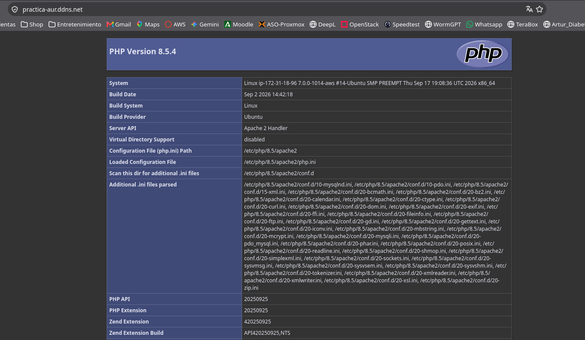
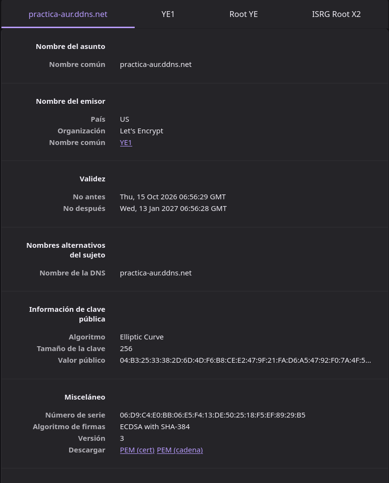
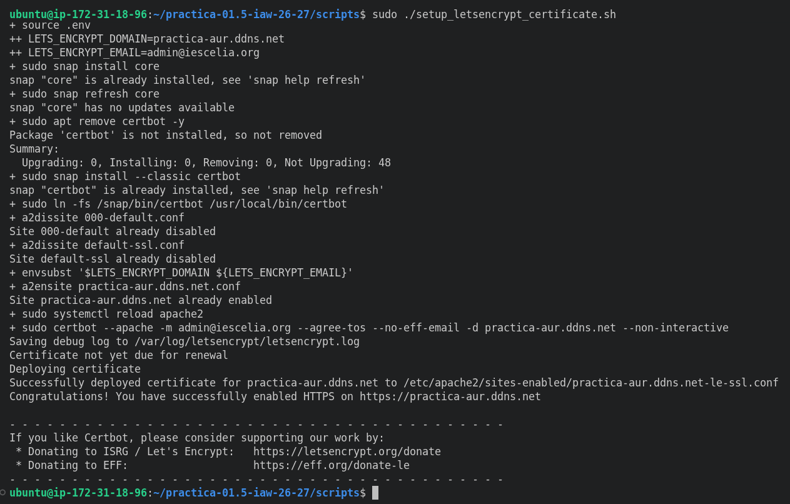

# Práctica 1.5: Despliegue Automatizado de Apache con HTTPS y Certificados de Let's Encrypt

Este repositorio contiene un conjunto de scripts en Bash y archivos de configuración para realizar el despliegue automatizado de una página web en un servidor web **Apache**, configurando el acceso seguro mediante protocolo **HTTPS (puerto 443)** con un certificado SSL **real y de confianza** emitido por la autoridad certificadora **Let's Encrypt**, solicitado y gestionado de forma automática con el cliente **Certbot**.

## Resultados a obtener

- **Sitio web accesible por HTTPS:** Debemos de poder acceder a la web sin que nos salte ningun aviso de seguridad en la web.

  

- **Certificado SSL válido emitido por Let's Encrypt:** Aqui podemos ver los datos del certificado y su fecha de expiracion

  

- **Ejecución automatizada con un solo comando:** Aqui podemos ver que se ha logrado ejecutar el script correctamente sin errores

  

## Estructura del repositorio

```
.
├── conf
│   ├── 000-default.conf
│   └── virtualhost.conf.template
├── php
│   └── index.php
├── README.md
├── screenshots
│   ├── browser.png
│   ├── certtificado.png
│   └── comando.png
└── scripts
    ├── install_lamp.sh
    └── setup_letsencrypt_certificate.sh
```

## 1. Archivos de Configuración (`conf/`)

### `conf/000-default.conf`

Este archivo define el VirtualHost principal por defecto de Apache para atender peticiones en el puerto 80. Se utiliza durante la instalación de la pila LAMP.

```apache
<VirtualHost *:80>
  DocumentRoot /var/www/html/

  DirectoryIndex index.php index.html

  ErrorLog ${APACHE_LOG_DIR}/error.log
  CustomLog ${APACHE_LOG_DIR}/access.log combined
</VirtualHost>
```

**Explicación de directivas:**

- `<VirtualHost *:80>`: Configura el servidor virtual para escuchar en cualquier dirección IP a través del puerto 80 (HTTP).

- `DocumentRoot /var/www/html/`: Especifica el directorio raíz desde el cual Apache servirá los archivos web.

- `DirectoryIndex index.php index.html`: Establece que el servidor buscará primero `index.php` y luego `index.html` al cargar un directorio.

- `ErrorLog` y `CustomLog`: Indican las rutas donde se almacenarán los registros de errores y de accesos del servidor.

### `conf/virtualhost.conf.template`

Plantilla del VirtualHost para el dominio propio. Contiene variables (`${LETS_ENCRYPT_DOMAIN}` y `${LETS_ENCRYPT_EMAIL}`) que se sustituyen por sus valores reales mediante `envsubst` al ejecutar el script. Certbot necesita que exista un VirtualHost con `ServerName` para poder identificar el dominio y añadir la configuración SSL.

```apache
<VirtualHost *:80>
  ServerName ${LETS_ENCRYPT_DOMAIN}
  ServerAdmin ${LETS_ENCRYPT_EMAIL}
  DocumentRoot /var/www/html/

  DirectoryIndex index.php index.html

  ErrorLog ${APACHE_LOG_DIR}/error.log
  CustomLog ${APACHE_LOG_DIR}/access.log combined
</VirtualHost>
```

**Explicación de directivas:**

- `ServerName ${LETS_ENCRYPT_DOMAIN}`: Nombre de dominio para el que responde este VirtualHost y para el que se emitirá el certificado.

- `ServerAdmin ${LETS_ENCRYPT_EMAIL}`: Correo electrónico del administrador del servidor.

- `${APACHE_LOG_DIR}`: Variable propia de Apache (no se sustituye con `envsubst`, ya que solo se indican las variables de Let's Encrypt).

## 2. Código Fuente PHP (`php/`)

### `php/index.php`

Página web inicial de prueba para comprobar el funcionamiento del intérprete de PHP en el servidor web.

```php
<?php

phpinfo();

?>
```

- **Función:** Genera una página informativa con los parámetros de configuración de PHP, módulos cargados, detalles del servidor web y variables de entorno.

## 3. Control de Versiones (`.gitignore`)

### `.gitignore`

Fichero empleado para evitar que Git rastree archivos sensibles o generados localmente.

```
.env
```

- **Función:** Ignora cualquier archivo `.env` local para prevenir la exposición accidental de datos del entorno en repositorios públicos.

## 4. Scripts de Automatización (`scripts/`)

### `scripts/.env.example`

Plantilla de variables de entorno requeridas para parametrizar la solicitud del certificado. Hay que copiarla como `.env` y rellenarla antes de ejecutar el script.

```
#Dominio para el que se solicita el certificado
LETS_ENCRYPT_DOMAIN=

#Correo electrónico para registrar el certificado y recibir avisos de caducidad
LETS_ENCRYPT_EMAIL=
```

### `scripts/install_lamp.sh`

Script encargado de instalar y configurar la pila LAMP base.

```bash
#!/bin/bash
set -ex

#Actualizar repositorios
apt update

#Instalamos apache
sudo apt install apache2 -y

#Copiamos el archivo de configuracion de Apache
cp ../conf/000-default.conf /etc/apache2/sites-available/

#Habilitamos el modulo de escritura de Apache
sudo a2enmod rewrite

#Instalamos PHP
sudo apt install php libapache2-mod-php php-mysql -y

#Reiniciamos el servicio de Apache para aplicar los cambios
systemctl restart apache2

#Copiamos el archivo index.php a la carpeta raiz del servidor web
cp ../php/index.php /var/www/html

#Cambiamos el propietario y el grupo de la carpeta /var/www/html a www-data
sudo chown -R www-data:www-data /var/www/html

#Instalamos el sistema gestor de bases de datos MySQL
sudo apt install mysql-server -y
```

Este script es el mismo que el de repositorios anteriores, por lo que sus comandos ya han sido explicados en ellos y se obviara.

### `scripts/setup_letsencrypt_certificate.sh`

Script que automatiza la instalación de Certbot, la creación del VirtualHost del dominio y la solicitud del certificado SSL a Let's Encrypt.

```bash
#!/bin/bash
set -ex

#Importamos las variables de entorno
set -a
source .env

#Realizamos la instalacion y actualizacion de snapd
sudo snap install core
sudo snap refresh core

#Eliminamos si existiese alguna instalacion previa de certbot con apt
sudo apt remove certbot -y

#Instalamos el cliente de Certbot
sudo snap install --classic certbot

#Creamos un alias para el comando certbot
sudo ln -fs /snap/bin/certbot /usr/local/bin/certbot

#Deshabilitamos los virtual hosts por defecto de Apache
a2dissite 000-default.conf
a2dissite default-ssl.conf

#Creamos el virtual host para el nuevo dominio usando el template de configuracion
envsubst '$LETS_ENCRYPT_DOMAIN ${LETS_ENCRYPT_EMAIL}' < ../conf/virtualhost.conf.template > /etc/apache2/sites-available/${LETS_ENCRYPT_DOMAIN}.conf

#Habilitamos el virtual host de Apache para nuestro dominio
a2ensite ${LETS_ENCRYPT_DOMAIN}.conf

#Recargamos la configuracion de Apache para que tome los cambios realizados
sudo systemctl reload apache2

#Ejecutamos el comando para obtener el certificado SSL de Let's Encrypt
sudo certbot --apache -m $LETS_ENCRYPT_EMAIL --agree-tos --no-eff-email -d $LETS_ENCRYPT_DOMAIN --non-interactive
```

**Explicación de comandos y bloques:**

- `set -a` y `source .env`: Activa la exportación automática de variables y carga el fichero `.env`, de modo que `LETS_ENCRYPT_DOMAIN` y `LETS_ENCRYPT_EMAIL` queden disponibles como variables de entorno (necesario para que `envsubst` pueda leerlas).

- `sudo snap install core` y `sudo snap refresh core`: Instalan y actualizan el núcleo de **snap**, el sistema de paquetes con el que se distribuye Certbot oficialmente.

- `sudo snap install --classic certbot`: Instala el cliente Certbot. La opción `--classic` le da acceso completo al sistema, necesario para modificar la configuración de Apache.

- `sudo ln -fs /snap/bin/certbot /usr/local/bin/certbot`: Crea un enlace simbólico (alias) para poder ejecutar `certbot` desde cualquier ruta. La opción `-f` sobrescribe el enlace si ya existe y `-s` lo crea como simbólico.

- `envsubst '$LETS_ENCRYPT_DOMAIN ${LETS_ENCRYPT_EMAIL}' < ... > ...`: Toma la plantilla `virtualhost.conf.template`, sustituye únicamente las variables indicadas por sus valores y guarda el resultado como `/etc/apache2/sites-available/<dominio>.conf`.

- `sudo certbot --apache ...`: Solicita el certificado a Let's Encrypt y configura Apache automáticamente (crea el VirtualHost del puerto 443 y la redirección HTTP → HTTPS):

  * `-m $LETS_ENCRYPT_EMAIL`: Correo electrónico de contacto para avisos de caducidad.

  * `--agree-tos`: Acepta automáticamente los términos de servicio de Let's Encrypt.

  * `--no-eff-email`: Rechaza recibir correos informativos de la EFF.

  * `-d $LETS_ENCRYPT_DOMAIN`: Dominio para el que se emite el certificado.

  * `--non-interactive`: Ejecuta el proceso sin pedir ninguna confirmación al usuario.

